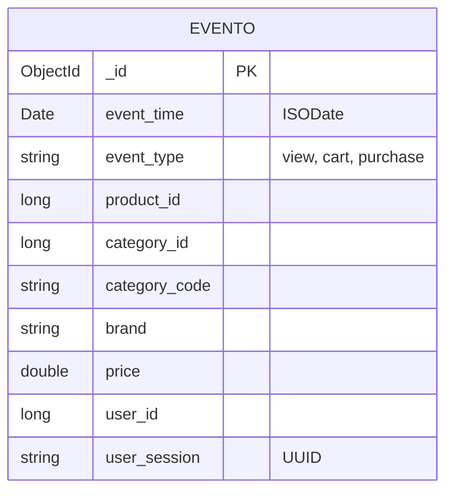

# Entregable 3: Modelo de Datos y Estructura de Almacenamiento

**Asignatura:** Bases de Datos II — Proyecto Parcial  
**Base de Datos:** `ecommerce_analytics`  
**Colección Principal:** `eventos`  
**Motor:** MongoDB 7.0 (WiredTiger Storage Engine)  

---

## 1. Justificación del Modelo NoSQL Documental
El modelo documental de MongoDB es idóneo para el análisis de flujos continuos de eventos (*Event Streams*) por las siguientes razones:

1. **Inmutabilidad y Alto Throughput:** Cada evento representa un hecho inmutable ocurrido en un instante temporal preciso. MongoDB permite miles de escrituras concurrentes por segundo sin bloqueos de tabla relacionales pesados.
2. **Polimorfismo y Flexibilidad de Esquema:** Distintos eventos poseen grados variables de atributos (algunos productos tienen taxonomía completa `category_code`, otros solo marca o identificador). Un esquema documental aloja estas variaciones de forma natural sin requerir uniones (`JOIN`) dispersas entre tablas relacionales normalizadas.
3. **Optimización para Agregación:** Agrupar y resumir transacciones sobre una única colección masiva aprovecha al máximo la memoria RAM de WiredTiger y los índices compuestos B-Tree.

---

## 2. Esquema BSON del Documento (`eventos`)

Cada documento en la colección `eventos` representa una interacción unitaria de un usuario:

```json
{
  "_id": ObjectId("6af0f1b9269292bf433925bd"),
  "event_time": ISODate("2019-10-01T00:00:00.000Z"),
  "event_type": "purchase",
  "product_id": 44600062,
  "category_id": NumberLong("2103807459595387724"),
  "category_code": "electronics.smartphone",
  "brand": "apple",
  "price": 999.00,
  "user_id": 541312140,
  "user_session": "72d76fde-8bb3-4e00-8c23-a032dfed738c"
}
```

### Diccionario de Datos

| Campo | Tipo BSON | Descripción | Restricciones / Valores Permitidos |
| :--- | :--- | :--- | :--- |
| `_id` | `ObjectId` | Identificador único del documento en MongoDB. | Generado automáticamente con timestamp y entropía. |
| `event_time` | `Date` (ISODate) | Marca temporal precisa del evento en formato UTC. | Indispensable para agrupamientos cronológicos e índices. |
| `event_type` | `string` | Tipo de evento ejecutado por el usuario. | `"view"`, `"cart"`, `"remove_from_cart"`, `"purchase"`. |
| `product_id` | `int64` / `int32` | Identificador numérico único del producto. | Referencia al catálogo de artículos. |
| `category_id` | `int64` (NumberLong) | Identificador único de la categoría. | Entero de 64 bits para categorías globales. |
| `category_code` | `string` | Taxonomía jerárquica por puntos. | Ej. `"electronics.smartphone"`, `"computers.notebook"`. |
| `brand` | `string` | Marca o fabricante comercial. | Ej. `"apple"`, `"samsung"`, `"xiaomi"`, `"lenovo"`. |
| `price` | `double` | Precio del artículo en dólares (USD). | Decimal de punto flotante de doble precisión. |
| `user_id` | `int64` / `int32` | Identificador del cliente. | Permite trazabilidad y cálculo de clientes VIP. |
| `user_session` | `string` | Identificador de la sesión de navegación. | UUID de 36 caracteres representativo de la sesión web. |

---

## 3. Relaciones y Agregación
En lugar de forzar un diseño relacional de Tercera Forma Normal (3FN) con tablas separadas de `usuarios`, `productos`, `marcas` y `sesiones` que demandarían costosos `$lookup` sobre decenas de millones de registros, el modelo adopta la **desnormalización estratégica**:



### Ventajas Técnicas:
1. **Zero-Lookup Aggregations:** Toda métrica de los 10 informes se calcula en un solo pase de lectura indexado sobre la colección `eventos`.
2. **Escalabilidad Horizontal:** Al no existir claves foráneas ni transacciones distribuidas entre tablas, la colección puede distribuirse limpiamente en un clúster particionado (*Sharded Cluster*) si la demanda lo exigiera.
3. **Change Streams Directos:** Cada inserción unitaria contiene el contexto comercial completo (monto, marca, categoría y usuario), permitiendo que el WebSocket notifique al frontend sin tener que hacer consultas secundarias.
