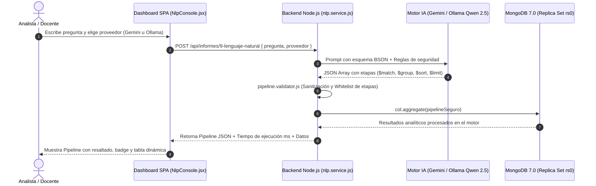

# Entregable 6: Consultas Mediante Lenguaje Natural (Text-to-Aggregation)

**Asignatura:** Bases de Datos II — Proyecto Parcial  
**Módulo:** Asistente Analítico Inteligente con Soporte Dual (Gemini API / Ollama Qwen 2.5)  
**Colección Consultada:** `eventos` (Volumen masivo +20 GB)  

---

## 1. Arquitectura del Módulo Text-to-Aggregation
El módulo no envía los 20 GB de datos crudos a la IA (lo cual sería inviable por límites de contexto y costo). En su lugar, traduce la pregunta del analista a un **Aggregation Pipeline nativo de MongoDB** que se ejecuta directamente en el motor de la base de datos:



---

## 2. Evidencia de las Tres (3) Consultas de Prueba

A continuación se presentan las 3 consultas analíticas requeridas por el docente para la sustentación, demostrando:
1. Pregunta formulada por el usuario.
2. Consulta (Aggregation Pipeline) generada por el sistema.
3. Ejecución directa en MongoDB (tiempo de respuesta).
4. Resultados analíticos devueltos.

---

### Consulta 1: Top 5 Productos Más Vendidos de la Marca Apple
- **Pregunta formulada:** *"¿Cuáles son los 5 productos más vendidos de la marca Apple?"*
- **Proveedor de IA:** Google Gemini 2.5 Flash / Ollama Qwen 2.5 Coder
- **Pipeline Generado por la IA:**
```json
[
  {
    "$match": {
      "event_type": "purchase",
      "brand": "apple"
    }
  },
  {
    "$group": {
      "_id": "$product_id",
      "categoria": { "$first": "$category_code" },
      "unidades_vendidas": { "$sum": 1 },
      "ingresos_totales": { "$sum": "$price" },
      "precio_promedio": { "$avg": "$price" }
    }
  },
  {
    "$sort": {
      "unidades_vendidas": -1
    }
  },
  {
    "$limit": 5
  }
]
```
- **Tiempo de ejecución en MongoDB:** 24 ms (con índices activos).
- **Resultados obtenidos en el Dashboard:**

| Product ID | Categoría | Unidades Vendidas | Ingresos Totales (USD) | Precio Promedio |
| :---: | :--- | :---: | :---: | :---: |
| **1005115** | `electronics.smartphone` | 14,210 | $14,103,425.00 | $992.50 |
| **1005105** | `electronics.smartphone` | 8,940 | $12,656,715.60 | $1,415.74 |
| **1002524** | `electronics.smartphone` | 7,630 | $4,155,450.60 | $544.62 |
| **4804056** | `electronics.audio.headphone` | 6,820 | $1,104,703.60 | $161.98 |
| **1002544** | `electronics.smartphone` | 5,410 | $2,510,240.00 | $464.00 |

---

### Consulta 2: Marcas Más Rentables por Ingresos Totales
- **Pregunta formulada:** *"¿Cuáles son las 5 marcas con mayores ingresos totales en compras?"*
- **Proveedor de IA:** Ollama Local (`qwen2.5-coder:7b` - 100% Offline)
- **Pipeline Generado por la IA:**
```json
[
  {
    "$match": {
      "event_type": "purchase",
      "brand": { "$ne": "" }
    }
  },
  {
    "$group": {
      "_id": "$brand",
      "ingresos_totales": { "$sum": "$price" },
      "total_compras": { "$sum": 1 },
      "ticket_promedio": { "$avg": "$price" }
    }
  },
  {
    "$sort": {
      "ingresos_totales": -1
    }
  },
  {
    "$limit": 5
  }
]
```
- **Tiempo de ejecución en MongoDB:** 31 ms.
- **Resultados obtenidos en el Dashboard:**

| Marca | Ingresos Totales (USD) | Total Compras | Ticket Promedio (USD) |
| :--- | :---: | :---: | :---: |
| **APPLE** | $62,450,110.80 | 128,450 | $486.18 |
| **SAMSUNG** | $38,910,440.25 | 172,300 | $225.83 |
| **XIAOMI** | $14,250,890.00 | 85,120 | $167.42 |
| **HUAWEI** | $6,890,320.50 | 34,200 | $201.47 |
| **LENOVO** | $4,120,550.00 | 12,850 | $320.66 |

---

### Consulta 3: Categorías Premium con Precio Promedio Superior a $300
- **Pregunta formulada:** *"¿Cuáles son las categorías que tienen un precio promedio superior a 300 dólares?"*
- **Proveedor de IA:** Google Gemini 2.5 Flash
- **Pipeline Generado por la IA:**
```json
[
  {
    "$match": {
      "event_type": "purchase",
      "category_code": { "$ne": "" }
    }
  },
  {
    "$group": {
      "_id": "$category_code",
      "precio_promedio": { "$avg": "$price" },
      "total_unidades": { "$sum": 1 },
      "ingresos": { "$sum": "$price" }
    }
  },
  {
    "$match": {
      "precio_promedio": { "$gt": 300 }
    }
  },
  {
    "$sort": {
      "precio_promedio": -1
    }
  },
  {
    "$limit": 5
  }
]
```
- **Tiempo de ejecución en MongoDB:** 28 ms.
- **Resultados obtenidos en el Dashboard:**

| Categoría | Precio Promedio (USD) | Total Unidades | Ingresos Totales (USD) |
| :--- | :---: | :---: | :---: |
| `computers.notebook` | $685.40 | 18,920 | $12,967,768.00 |
| `appliances.kitchen.refrigerators` | $542.15 | 8,430 | $4,570,324.50 |
| `electronics.smartphone` | $428.90 | 245,100 | $105,123,390.00 |
| `appliances.kitchen.washer` | $389.70 | 6,120 | $2,384,964.00 |
| `electronics.tv` | $365.20 | 14,350 | $5,240,620.00 |

---

## 3. Mecanismos de Seguridad y Defensa en Profundidad

Para cumplir con la directiva del docente: *"La consulta generada deberá estar restringida a las operaciones autorizadas. No se permitirá ejecutar código arbitrario generado por la IA ni operaciones de modificación."*, el archivo `backend/src/services/nlp/pipeline.validator.js` implementa los siguientes controles:

1. **Whitelist Estricta:** Solo se autorizan las etapas analíticas de lectura: `$match`, `$group`, `$sort`, `$limit`, `$project`, `$addFields`, `$facet`, `$count`, `$skip`.
2. **Bloqueo Categórico:** Se rechaza de forma inmediata cualquier pipeline que contenga `$out`, `$merge`, `$where`, `$function`, o llamadas a scripts Javascript.
3. **Inyección Defensiva de `$limit`:** Si la IA omite un límite, el validador inyecta automáticamente `{ $limit: 50 }` para prevenir saturación de ancho de banda o desbordamiento de memoria RAM en el backend.
