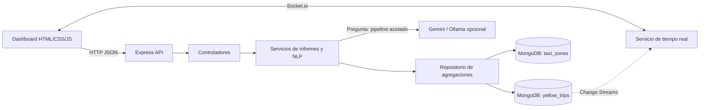

# Entregable 9: Arquitectura

La presentación solo consume la API. Los controladores procesan HTTP; los servicios aplican límites y reglas; el repositorio concentra las agregaciones ejecutadas por MongoDB. El módulo NLP valida la salida del modelo antes de consultar la colección. Change Streams sobre el Replica Set reciben los viajes nuevos del simulador y Socket.io actualiza tres elementos del dashboard: KPIs, zonas de recogida y tabla de viajes recientes.
