# 📘 Explicación Exhaustiva del Código Fuente y Arquitectura
**Asignatura:** Bases de Datos II — Proyecto Parcial  
**Objetivo:** Guía de comprensión profunda de cada archivo, función y patrón de diseño implementado.

---

## 1. El Mapa Mental: El Viaje de un Dato (De MongoDB a la Pantalla)

```mermaid
flowchart TD
    subgraph FLUJO_A["Flujo 1: Consulta Analítica Tradicional (HTTP REST)"]
        U1["1. Usuario en el Navegador"] -->|"GET /api/informes/3-marcas-rentables"| R1["2. Enrutador (api.routes.js)"]
        R1 --> C1["3. Controlador (reportes.controller.js)"]
        C1 --> S1["4. Servicio (reportes.service.js)"]
        S1 --> REPO1["5. Repositorio (eventos.repository.js)"]
        REPO1 -->|"Aggregation Pipeline Nativo"| MDB1[("6. MongoDB (25 GB / 116M docs)")]
        MDB1 -->|"Resumen Agregado (solo 10 filas)"| REPO1
        REPO1 --> S1 --> C1 -->|"JSON { success: true, data: [...] }"| U1
    end

    subgraph FLUJO_B["Flujo 2: Notificación en Tiempo Real (Change Streams)"]
        SIM["1. Simulador de Compras"] -->|"insert_one(doc)"| MDB2[("2. MongoDB Oplog")]
        MDB2 -.->|"Change Stream: .watch()"| SOCK["3. realTime.socket.js"]
        SOCK -->|"Socket.io emit('nueva_transaccion')"| BRO["4. Navegador del Portátil / PC"]
        BRO -->|"Animación Flash Verde + Incremento KPI"| DOM["5. Pantalla (Informes 1, 2 y 10)"]
    end
```



---

## 2. Capa de Base de Datos y Scripts (`database/`)

### A. `database/scripts/importar_datos.py`
**¿Qué hace?:** Realiza la ingesta de los CSVs de Kaggle (`2019-Oct.csv` y `2019-Nov.csv`) hacia MongoDB sin saturar la memoria RAM.
- **Técnica de Chunks:** Utiliza `pd.read_csv(..., chunksize=100_000)` para leer bloques de 100,000 filas en streaming.
- **Saneamiento de Tipos BSON (Fundamental para el profesor):**
  - `pd.to_datetime(...)`: Convierte cadenas de fecha a objetos `datetime` de Python, que el driver de MongoDB almacena como BSON `ISODate`.
  - `pd.to_numeric(..., errors='coerce')`: Garantiza que `price` sea `float` y `user_id`, `product_id` sean `int64`.
- **Inserción Desordenada (`ordered=False`):** `col.insert_many(docs, ordered=False)` le indica a MongoDB que inserte en paralelo por lotes sin detenerse si hay anomalías menores.

---

### B. `database/indexes/indices.js`
**¿Qué hace?:** Construye las estructuras B-Tree en memoria RAM para optimizar los 10 informes.
- **Regla ESR (Equality, Sort, Range):**
  - Ejemplo: `{ event_type: 1, event_time: -1 }`.
  - Primero filtra por igualdad estricta (`event_type: 'purchase'`).
  - Luego aprovecha que las ramas del árbol ya están ordenadas por `event_time: -1`, evitando que MongoDB gaste memoria haciendo ordenamientos (`Sort in Memory`).
- **Índice de Texto (`idx_text_category_brand`):**
  - `{ category_code: "text", brand: "text" }` crea un índice de inversión léxica para búsquedas libres de catálogo.

---

### C. `database/scripts/simulador_tiempo_real.py`
**¿Qué hace?:** Genera eventos de compra realistas durante la sustentación.
- Selecciona al azar productos de un catálogo predefinido (iPhone 11 Pro, Samsung Galaxy, AirPods) y usuarios VIP.
- Asigna un `uuid.uuid4()` único y la fecha actual UTC (`datetime.now(timezone.utc)`).
- Ejecuta `col.insert_one(doc)` cada 1.5 a 3 segundos.
- Al insertar, despierta automáticamente el Oplog de MongoDB.

---

### D. `database/benchmarks/comparativa_explain.js`
**¿Qué hace?:** Ejecuta una consulta de prueba cronológica y extrae las métricas del planificador de MongoDB:
- `winningPlan.stage`: Identifica si usó `IXSCAN` (índice) o `COLLSCAN` (escaneo secuencial).
- `executionTimeMillis`, `totalDocsExamined` y `nReturned`: Demuestra que la relación de documentos leídos frente a devueltos es de 1 a 1.

---

## 3. Capa de Repositorio: Aggregation Pipelines Puros (`backend/src/repositories/eventos.repository.js`)

Esta capa encapsula el 100% de las consultas a MongoDB:

### Informe 1: Ventas por Periodo y KPIs Globales
```javascript
{
  $facet: {
    serie_diaria: [
      { $group: { _id: { $dateToString: { format: '%Y-%m-%d', date: '$event_time' } }, total_compras: { $sum: 1 }, ingresos: { $sum: '$price' } } },
      { $sort: { _id: 1 } }
    ],
    resumen_kpi: [
      { $group: { _id: null, ingresos_totales: { $sum: '$price' }, compras_totales: { $sum: 1 } } }
    ]
  }
}
```
* **¿Por qué `$facet`?:** Permite ejecutar dos agregaciones en paralelo en una sola pasada sobre el disco: la serie de tiempo para el gráfico de líneas y las tarjetas KPI de totales globales.

### Informe 2: Top Productos Más Vendidos
* Agrupa por `$product_id`, acumula `unidades_vendidas: { $sum: 1 }` e `ingresos_generados: { $sum: '$price' }`, ordena descendentemente y aplica `$limit: 15`.

### Informe 3: Marcas Más Rentables
* Agrupa por `$brand` y calcula el `ticket_promedio: { $avg: '$price' }` para conocer la rentabilidad media.

### Informe 6: Embudo de Conversión (Funnel)
* Agrupa por `event_type` (`view`, `cart`, `purchase`, `remove_from_cart`).
* Calcula el ratio de conversión y la tasa de abandono de carrito:
  $$\text{Tasa de Abandono} = \frac{\text{cart} - \text{purchase}}{\text{cart}} \times 100$$

### Informe 7: Mapa de Calor 7x24
* Agrupa por `{ dia_semana: { $isoDayOfWeek: '$event_time' }, hora: { $hour: '$event_time' } }`.

### Informe 8: Detección de Caída de Demanda (Alertas)
* Utiliza una condición booleana `$cond` dentro del `$group`:
  - `ventas_periodo_1: { $sum: { $cond: [{ $lt: ['$event_time', fechaCorte] }, 1, 0] } }`
  - `ventas_periodo_2: { $sum: { $cond: [{ $gte: ['$event_time', fechaCorte] }, 1, 0] } }`
* Luego con `$project` resta ambos periodos para hallar `caida_unidades` y calcular el porcentaje de descenso.

---

## 4. Módulo de Inteligencia Artificial Dual (`backend/src/services/nlp/`)

Implementa el **Patrón Adapter**, permitiendo conmutar en vivo entre dos proveedores sin alterar el resto de la aplicación:

### A. `pipeline.validator.js` (Seguridad Estricta)
- **Whitelist de Operadores:** Solo permite `$match`, `$group`, `$sort`, `$limit`, `$project`, `$addFields`, `$facet`, `$count`.
- **Bloqueo Defensivo:** Si el JSON devuelto por la IA incluye palabras peligrosas como `$out`, `$merge`, `$where`, `drop`, `delete` o funciones javascript, **aborta la ejecución y arroja error**.
- **Inyección de Límites:** Si la IA omitió un límite, inyecta automáticamente `{ $limit: 50 }` para proteger la memoria RAM.

### B. `gemini.provider.js`
- Conexión REST a Google Gemini (`gemini-2.5-flash`) mediante prompt estructurado.

### C. `ollama.provider.js`
- Conexión a `http://127.0.0.1:11434/api/generate` solicitando el modelo `qwen2.5-coder:7b` para modo 100% offline.

### D. `nlp.service.js`
- Orquesta la llamada al proveedor elegido (Gemini u Ollama).
- Pasa el pipeline resultante por `pipeline.validator.js`.
- Ejecuta en MongoDB con `{ maxTimeMS: 180000, allowDiskUse: true }` y cronometra el tiempo en ms.
- Posee un motor determinístico de respaldo para garantizar que las preguntas de sustentación siempre respondan sin importar caídas de red.

---

## 5. Capa de Tiempo Real (`backend/src/sockets/realTime.socket.js`)

**¿Cómo funciona la reactividad sin hacer polling?:**
1. MongoDB Replica Set escribe cada inserción en el Oplog.
2. El driver de Node.js se suscribe a este flujo mediante `col.watch([{ $match: { operationType: 'insert' } }])`.
3. Cuando entra una compra relevante (`event_type: 'purchase'`):
   ```javascript
   changeStream.on('change', (change) => {
     const doc = change.fullDocument;
     if (doc.event_type === 'purchase') {
       io.emit('nueva_transaccion', doc); // Para Informe 10
       io.emit('incremento_venta', { monto: doc.price, ... }); // Para Informes 1 y 2
     }
   });
   ```
4. Los navegadores conectados por WebSocket reciben el paquete JSON al instante y actualizan el DOM en milisegundos.

---

## 6. Frontend Dashboard SPA (`frontend/public/`)

Construido con JavaScript modular moderno sin empaquetadores pesados para máxima velocidad de carga:
- `index.html`: Maquetación semántica dividida en 5 pestañas temáticas.
- `styles/main.css`: Paleta visual oscura y animaciones reactivas para transacciones.
- `js/api.js`: Cliente de comunicación REST con el backend.
- `js/socket.js`: Manejo de WebSockets, estado del servidor y recepción de compras.
- `js/charts.js`: Renderizado y actualización reactiva de Chart.js.
- `js/nlp.js`: Gestión del selector de IA, preguntas con un clic, visor de JSON y tablas dinámicas.
- `js/app.js`: Estado global en memoria (`state`) y orquestación general.
